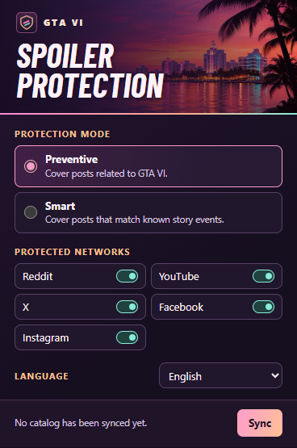

# GTA VI Spoiler Shield

[Español](README.es.md) · [Architecture](docs/architecture.md) · [Privacy](docs/privacy.md)

Browse Reddit, YouTube, X, Facebook and Instagram with GTA VI spoilers covered. The bilingual extension hides a whole card, including its thumbnail, and lets you reveal one post at a time with the keyboard or mouse.

| Preventive · default | Smart |
| --- | --- |
| Covers cards and replies clearly connected to GTA VI, even on the first offline visit. | Checks the local catalog for known events in English or Spanish, including disguised text. Continues using the last successful download offline. |

## Install

The first public build is being prepared. For a local installation, build from source using the [development guide](docs/development.md). The distribution channel is [GitHub Releases](https://github.com/cfrodriguezb17/gta-vi-spoiler-shield/releases).

- **Chrome desktop** — Extract the release’s `chrome.zip` into a permanent folder. Open `chrome://extensions`, enable Developer mode, choose **Load unpacked** and select that folder. For updates, replace the files in the same folder and click **Reload**.
- **Firefox desktop** — Open the signed `.xpi` from the release in Firefox and confirm installation. Install newer signed XPIs over the existing add-on. Firefox 140 or later is required.
- Reload existing social tabs. Use **Language** in the panel for English, Spanish or the browser default. **Sync** checks the public catalog. Smart mode can miss new events and unfamiliar paraphrases. Images and videos are filtered through nearby text and accessible labels.

## Project

[Architecture diagrams](docs/architecture.md) · [Catalog API](docs/api.md) · [Development](docs/development.md) · [Production runbook](docs/operations.md) · [Contributing](CONTRIBUTING.md) · [Security](SECURITY.md) · [Changes](CHANGELOG.md)

Independent fan project. The code uses the MIT license. See the [third-party notices](NOTICE.md) for font, artwork and source credits.
