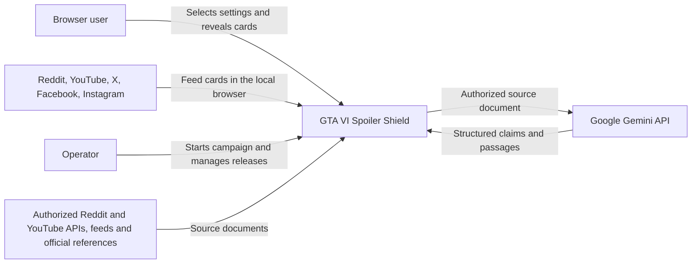
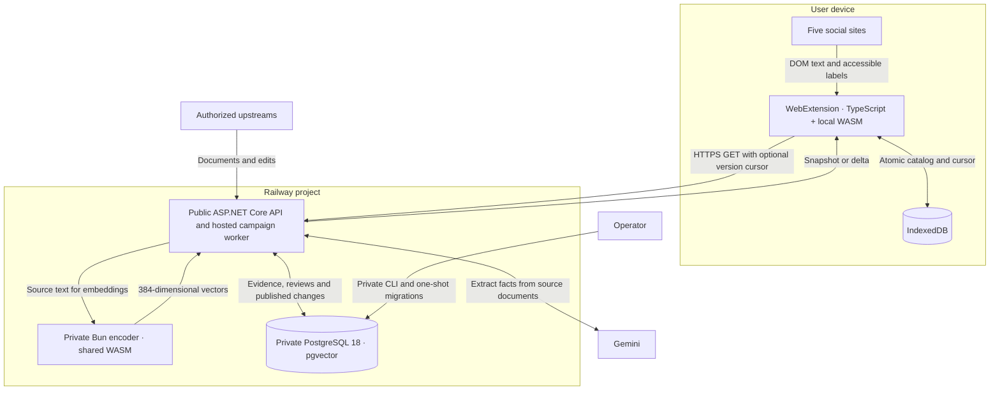

# Architecture

## C1 · System context

## C2 · Containers and trust boundaries

The bundled bilingual lexical encoder uses model version `vi-lex-es-en-384-v1`. PostgreSQL coordinates the campaign and publishes changes transactionally. The extension stores a cursor per active origin and replaces its catalog atomically after a change of origin. The public API and background worker share one process. Only the worker calls Gemini. GitHub Actions deploys the services and packages the browser builds from the same commit.
